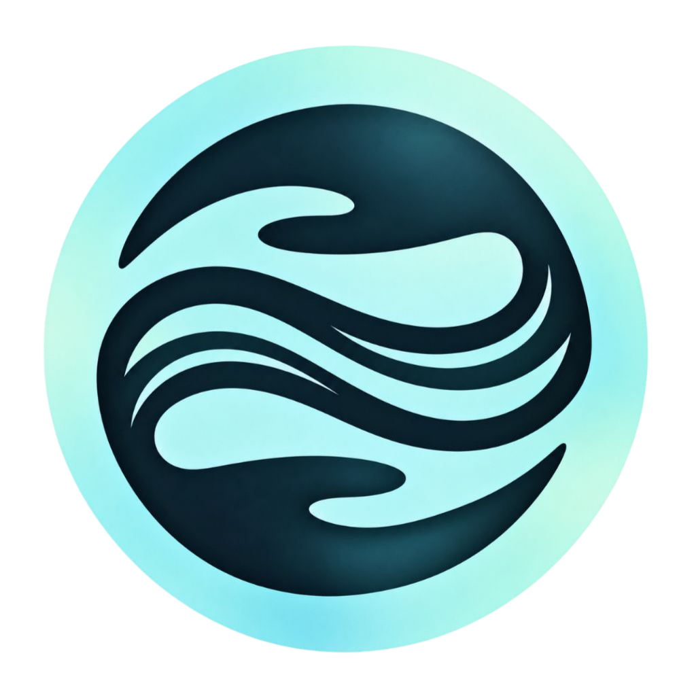
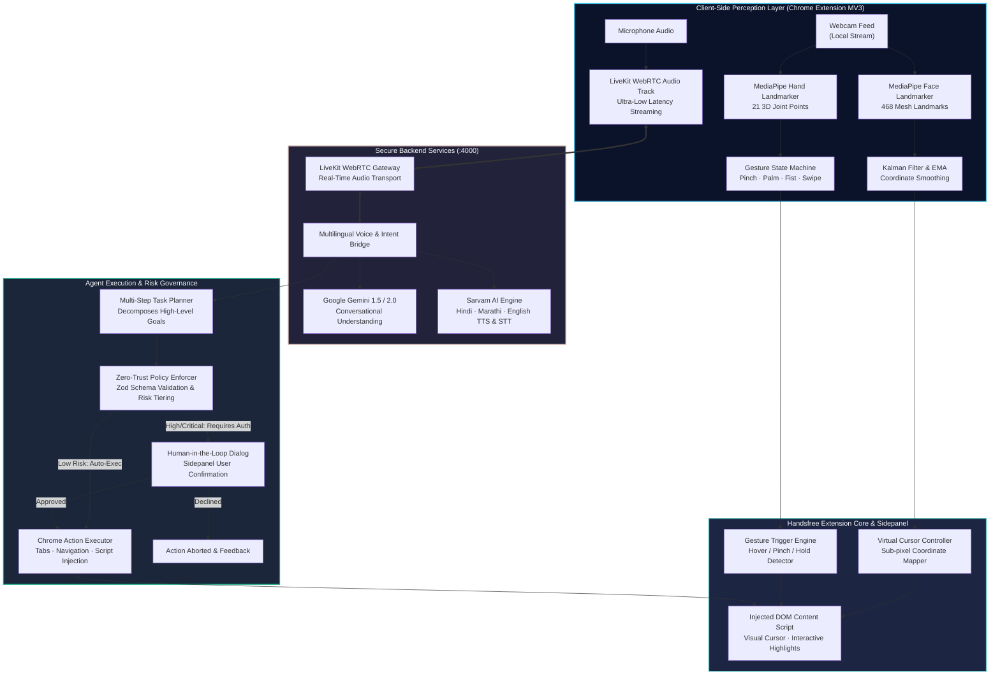
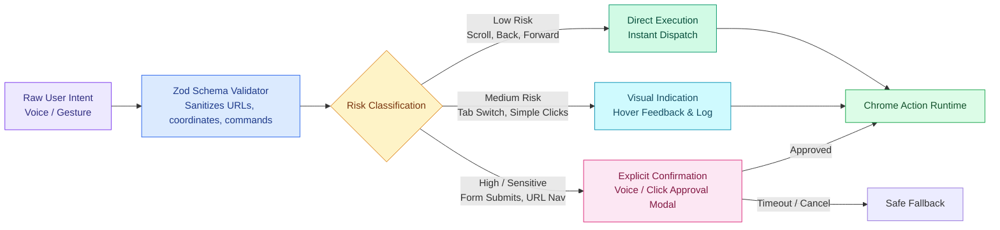

<div align="center">

  

  # Handsfree
  ### **Browse Beyond Your Hands**

  **An AI-Powered Multimodal Chrome Assistant bridging Human Intent and the Web through On-Device Computer Vision, Real-Time Conversational Voice, and Risk-Governed Browser Automation.**

  <p align="center">
    <a href="#overview"></a>
    <a href="#architecture"></a>
    <a href="#technology-stack"></a>
    <a href="#key-features"></a>
  </p>

  <p align="center">
    
    
    
    
    
    
    
  </p>

  <p align="center">
    <a href="#overview">Overview</a> •
    <a href="#system-architecture">System Architecture</a> •
    <a href="#core-capabilities">Core Capabilities</a> •
    <a href="#interaction-matrix">Interaction Matrix</a> •
    <a href="#technology-stack">Tech Stack</a> •
    <a href="#getting-started">Getting Started</a> •
    <a href="#security--privacy">Security & Safety</a> •
    <a href="#team-mac-n-code">Team</a>
  </p>

</div>

---

## 🌟 Overview

The modern web was built for two hands, a physical mouse, and a mechanical keyboard. For millions of individuals with motor impairments, temporary injuries, situational disabilities, or multitaskers in hands-busy environments, this legacy paradigm creates friction and barriers.

**Handsfree** is a next-generation Chrome Extension that breaks this barrier. By harmonizing **real-time on-device computer vision**, **ultra-low latency WebRTC voice streaming**, and **autonomous agentic planning**, Handsfree transforms standard web browsing into a fluid, hands-free experience.

Navigate complex web pages, click links, fill search inputs, trigger smart summarization, and control tabs using **only your head posture, natural hand gestures, or conversational voice commands in English, Hindi, and Marathi**.

```
   ┌──────────────────┐       ┌──────────────────┐       ┌──────────────────┐
   │   VISION INPUT   │       │   VOICE INPUT    │       │   INTENT ENGINE  │
   │  Head Tracking   │  ───► │  Real-time Audio │  ───► │  Multi-Step Plan │
   │  Hand Gestures   │       │  Multilingual    │       │  Safety Policies │
   └──────────────────┘       └──────────────────┘       └──────────────────┘
                                                                   │
                                                                   ▼
                                                         ┌──────────────────┐
                                                         │  BROWSER ACTION  │
                                                         │  Virtual Cursor  │
                                                         │  DOM Interaction │
                                                         └──────────────────┘
```

---

## 🏛️ System Architecture

Handsfree utilizes a distributed, modular pipeline designed for **zero-latency UI responsiveness**, **client-side privacy isolation**, and **zero-trust safety enforcement**.

### 1. End-to-End Multimodal Dataflow



### 2. Multi-Tier Action Policy & Safety Pipeline



---

## ⚡ Core Capabilities

### 🎯 1. On-Device Vision Tracking
- **60 FPS Dual Pipeline:** Computes 468 facial mesh landmarks and 21 3D hand points concurrently in WebAssembly via `@mediapipe/tasks-vision`.
- **Kalman & Exponential Smoothing:** Eliminates natural micro-tremors, head jitter, and webcam sensor noise for precise sub-pixel mouse targeting.
- **Dynamic Head Tracking:** Moves the pointer intuitively based on nose-tip and facial vectors with user-configurable sensitivity and deadzones.
- **Multi-Gesture Recognition:**
  - **Index-to-Thumb Pinch:** Instant left-click.
  - **Pinch & Hold:** Drag-and-drop, text selection, and continuous interaction.
  - **Open Palm:** Dynamic deceleration and precision mode.
  - **Closed Fist:** Interaction freeze / safety lock.

### 🗣️ 2. Conversational Multilingual Voice (LiveKit + Sarvam AI)
- **Ultra-Low Latency Streaming:** Powered by LiveKit WebRTC data and media channels for conversational interaction without awkward round-trip delays.
- **Multilingual Support:** Converses fluently and understands browser commands in **English, Hindi (हिंदी), and Marathi (मराठी)**.
- **Instant Interruption:** Spoken agent responses immediately duck or pause when the user speaks, mimicking true human conversation.
- **Smart Fallback:** Automatic failover to browser Web Speech API when offline or running in standalone mode.

### 🧠 3. Autonomous Multi-Step Planning
- **Sub-Goal Decomposition:** Converts high-level user commands into ordered execution trees.  
  *(e.g., "Search for cheap flights from Mumbai to Delhi on Google Flights and pick the morning option")*
- **DOM Self-Healing & Visual Feedback:** Intelligent selector heuristics targeting visible clickable elements, forms, and buttons with interactive element highlights.

### 🛡️ 4. Zero-Trust Policy & Safety Enforcer
- **Human-in-the-Loop Execution:** Consequential operations (such as payments, navigation to unverified domains, or form submissions) trigger visual confirmation dialogs.
- **Zod Schema Hardening:** Every payload is validated against strict types before execution—eliminating prompt injection hazards and errant agent commands.
- **Zero Webcam Transmission:** Camera frames are evaluated **100% on the local client machine**. Only processed landmark coordinates remain in memory; raw video is never sent over any network.

---

## 🎮 Interaction Matrix

| Input Modality | Action / Gesture | Browser Behavior | Safety Level |
|---|---|---|:---:|
| **Head Movement** | Subtle tilt or pan | Moves virtual screen cursor across active viewport | `Low` |
| **Hand Gesture** | Pinch (Index + Thumb) | Left Click / Trigger focused link or button | `Medium` |
| **Hand Gesture** | Pinch & Hold (>400ms) | Element Drag & Drop / Continuous Slider Control | `Medium` |
| **Hand Gesture** | Open Palm Facing Camera | Precision Mode (Dampens speed for fine selection) | `Low` |
| **Hand Gesture** | Closed Fist | Global Tracking Pause (Prevents misclicks) | `Safe` |
| **Voice Command** | *"Scroll down"* / *"खाली स्क्रोल करा"* | Smooth page scroll downwards by calibrated viewport delta | `Low` |
| **Voice Command** | *"Click on Documentation"* | Resolves DOM link text and dispatches verified click | `Medium` |
| **Voice Command** | *"Open YouTube in a new tab"* | Spawns tab and loads authenticated target URL | `Low` |
| **Voice Command** | *"Summarize this article"* | Gathers page text, runs Gemini summary in sidepanel | `Safe` |

---

## 🛠️ Technology Stack

<div align="center">

| Domain | Technology | Key Role in Handsfree |
|:---|:---|:---|
| **Frontend Framework** | `React 18 + TypeScript` | Type-safe Sidepanel UI, status overlays, reactive calibration controls |
| **Styling & Design** | `Tailwind CSS` | Modern glassmorphism design system, dark-mode styling, smooth transitions |
| **Build & Tooling** | `Vite 5` + `Rollup` | Dual-bundle architecture (Sidepanel / Background / Injected Content Script) |
| **Extension Platform** | `Chrome Manifest V3` | Service workers, isolated DOM content scripts, sidePanel API |
| **Computer Vision** | `Google MediaPipe` | On-device WebAssembly vision models (Face Mesh & Hand Landmarks) |
| **Voice Infrastructure** | `LiveKit WebRTC` | Full-duplex audio rooms, low-latency streaming audio transport |
| **Multilingual AI** | `Sarvam AI` | Indic language speech-to-text and voice synthesis (Hindi, Marathi, English) |
| **Conversational LLM** | `Google Gemini 1.5/2.0` | High-reasoning intent classification and multi-step plan generation |
| **Validation & Safety** | `Zod` | Runtime schema validation, strict action boundaries, policy enforcement |
| **Testing** | `Vitest` + `Playwright` | Unit tests for tracking algorithms, end-to-end browser automation suites |

</div>

---

## 🚀 Getting Started

### Prerequisites

- **Node.js** v18.0.0 or higher
- **npm** v9.0.0 or higher
- **Google Chrome** (Version 116+ recommended for Manifest V3 sidePanel support)
- A webcam and microphone

---

### Step 1: Clone the Repository

```bash
git clone https://github.com/How2Invade/MacandCode_college_round.git
cd MacandCode_college_round
npm install
```

---

### Step 2: Configure Environment Variables

Create your local `.env` file from the provided example:

```bash
cp .env.example .env
```

Add your API credentials in `.env`:

```env
# Backend Server Configuration
BACKEND_PORT=4000
BACKEND_HOST=localhost

# LiveKit WebRTC Infrastructure (https://cloud.livekit.io)
LIVEKIT_URL=wss://your-project.livekit.cloud
LIVEKIT_API_KEY=your_livekit_api_key
LIVEKIT_API_SECRET=your_livekit_api_secret

# Multimodal LLM & Indic Voice (https://aistudio.google.com & https://sarvam.ai)
GEMINI_API_KEY=your_gemini_api_key
GEMINI_MODEL=gemini-3.8-flash
SARVAM_API_KEY=your_sarvam_api_key
SARVAM_CHAT_MODEL=sarvam-105b-conversations

# Extension Debugging
VITE_ENABLE_DEBUG_LOGS=true
```

> **Security Note:** All private API keys and tokens reside strictly in the backend runtime. The client Chrome Extension communicates with the backend gateway via authenticated local WebRTC / HTTP channels.

---

### Step 3: Run the Development Server & Backend

In your primary terminal, start the secure backend voice & agent service:

```bash
npm run backend:dev
```
*(You will see: `[Handsfree Backend] Secure AI gateway listening on http://localhost:4000`)*

In a second terminal, launch the Vite compiler in watch mode:

```bash
npm run dev
```

---

### Step 4: Build the Extension

To compile the production Manifest V3 extension bundle:

```bash
npm run build
```

This compiles TypeScript, packages the content scripts via `vite.content.config.ts`, copies `manifest.json`, and outputs the complete extension package to the **`dist/`** directory.

---

### Step 5: Load into Google Chrome

1. Open Chrome and navigate to `chrome://extensions/`.
2. Toggle **Developer mode** in the upper-right corner.
3. Click the **Load unpacked** button.
4. Select the **`dist`** folder inside this project directory.
5. Open any webpage, click the **Handsfree** puzzle icon, and pin it to open the Sidepanel!

---

## 🔒 Security & Privacy by Design

- 🛡️ **Edge-Only Video Processing:** The webcam stream is strictly bound to on-device MediaPipe models in the browser sandbox. Video frames **never leave the user's machine**.
- 🛡️ **Zero-Trust Action Boundaries:** The AI agent cannot execute unrestricted arbitrary code. Actions are constrained to a predefined Zod-validated allowlist (`click_element`, `scroll_page`, `type_text`, `navigate_back`, `open_url`).
- 🛡️ **Confirmation Safeguards:** Critical operations (e.g. financial workflows, OAuth, or external redirects) trigger non-bypassable user confirmation prompts.
- 🛡️ **Ephemeral Memory:** Landmark coordinates and audio buffers are handled in memory and discarded immediately upon processing.

---

## 🔮 Vision & Impact

Accessibility is not a feature toggle—it is a fundamental human right in the digital era. **Handsfree** demonstrates how the convergence of **on-device computer vision**, **multimodal language models**, and **real-time WebRTC infrastructure** can redefine computer accessibility.

We are building toward a future where computing adapts to humans—not the other way around.

---

## 👥 Team Mac n Code

Crafted with passion, caffeine, and a commitment to accessible tech for all.

<div align="center">

| Team Member | Role & Focus |
|:---|:---|
| **Jeet Chavan** | Vision Pipeline & Landmark Stabilization |
| **Meet Mangaonkar** | Core Architecture, Extension Infrastructure & Content Script Engineering |
| **Sanika Lobo** | UI/UX Design System, Sidepanel Engineering & Accessibility Experience |
| **Yash Masaye** | Real-Time Voice Pipeline, LiveKit WebRTC & Multilingual AI Integration |

<br/>

<p align="center">
  
</p>

**Handsfree — Browse Beyond Your Hands.**

</div>
